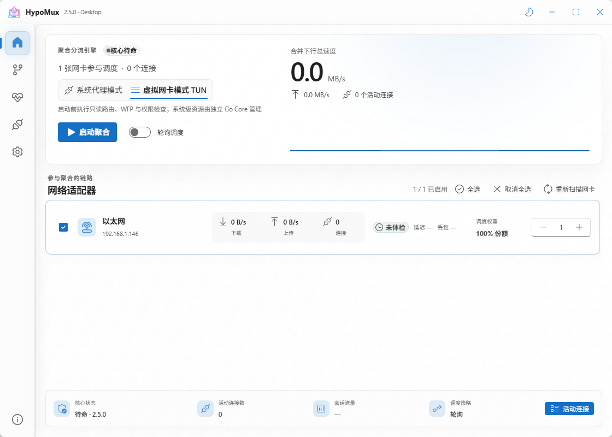
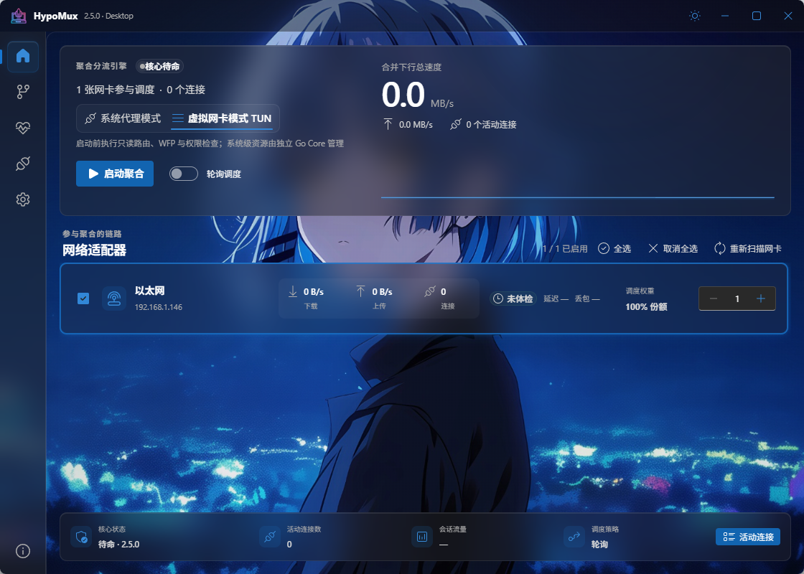

# HypoMux

<p align="center">
  <br><br>
  <a href="README.md">简体中文</a> | <a href="README_EN.md">English</a>
</p>

<p align="center">
  
  
  
  
  
</p>

HypoMux 是一款面向 Windows 的开源多网卡聚合与分流工具。它把多连接下载任务分配到多张活动网卡，让有线网络、Wi-Fi、手机热点或 USB 网络共享能够同时承担流量。

HypoMux 聚合的是多个独立连接，而不是把单条 TCP 连接拆成多路。因此，它尤其适合 Steam、IDM、游戏平台更新器、浏览器大文件下载等高并发场景；单连接任务的速度仍受该连接本身限制。

官方网站与使用文档：[https://hypomux.com](https://hypomux.com)

## 下载

> **Windows 安装包：**[GitHub Releases](https://github.com/Hypostasis-Cat/HypoMux/releases/latest) · [腾讯 CNB Release](https://cnb.cool/Hypostasis-Cat/HypoMux/-/releases/latest)
>
> 下载最新版 `HypoMux_Setup_*.exe`。签名与发布方式见[代码签名政策（Code signing policy）](#赞助方)。

## 界面预览

<p align="center">
  
</p>

<p align="center">
  
</p>

## 核心功能

- **系统代理模式**：启动本地 HTTP/HTTPS 与 SOCKS5 服务；默认接管 Windows 系统代理，也可关闭接管、仅向手动配置的应用提供本地端口。
- **虚拟网卡模式**：通过 Wintun 与 sing-box 接管更广泛的系统流量，并结合 WFP、DNS 和路由规则完成精细分流。
- **多网卡连接调度**：为每个新连接选择出站网卡，并使用源地址绑定与 `IP_UNICAST_IF` 将套接字固定到真实物理链路。
- **高级路由规则**：按进程、域名、IP/CIDR 指定聚合、直连、以太网、Wi-Fi 或某张具体网卡。
- **单网卡受限域名处理**：记录特定链路不可访问的域名，避免后续连接继续分配到该链路。
- **加密 DNS**：支持 DoH 与自定义 DoT（`tls://域名[:端口]`，在“设置 → 网络与 DNS”配置）。校验服务器证书，DoT 查询失败不会降级为明文 DNS。
- **实时状态与诊断**：展示每张网卡的速率、连接数和聚合吞吐，并提供丢包、延迟、抖动、DNS、网关及源地址绑定检查。
- **最小权限架构**：界面不以管理员身份常驻；正式安装后，仅独立 Core 服务持有必要的网络管理权限。

### 两种运行模式如何选择

| 模式 | 覆盖范围 | 权限与兼容性 | 推荐场景 |
| --- | --- | --- | --- |
| 系统代理 | 遵循 Windows 系统代理的应用，或手动填写本地 HTTP/SOCKS5 端口的应用 | 更轻量；可关闭系统代理接管；不创建虚拟网卡 | IDM、浏览器、Steam 等代理感知型下载 |
| 虚拟网卡 | 更广泛的 TCP/UDP 与非代理感知流量 | 需要 Core 服务、Wintun/WFP；不能与其他 TUN 同时接管默认路由 | 游戏平台下载、WeGame、复杂分流和全局接管 |

## 快速开始

1. 让电脑同时连接至少两条可用网络，例如有线宽带 + Wi-Fi，或宽带 + 手机 USB/热点共享。
2. 启动 HypoMux，在首页刷新并勾选要加入聚合池的活动网卡。
3. 先运行“网络体检”，确认各链路具有有效 IPv4、网关、DNS 和源地址绑定能力。
4. 选择系统代理或虚拟网卡模式。低延迟游戏、语音和会议程序可先加入直连规则。
5. 开启聚合引擎，再启动下载任务。若 Steam 已经运行，按界面提示重启 Steam 以完整应用代理设置。
6. 使用完毕后停止聚合或正常退出，HypoMux 会恢复其接管的系统网络设置。

## 命令行（CLI）

安装版自带官方命令行客户端 `bin\hypomux-cli.exe`。它与界面走同一条经认证的 Core 服务管道（按安装路径 + SHA-256 指纹认证），控制的是同一个聚合引擎，适合脚本和 AI Agent 无人值守调用：

```powershell
# 查看可用于聚合的网卡，并以系统代理模式启动
hypomux-cli adapters
hypomux-cli start --adapter Ethernet --adapter "Wi-Fi:3" --socks-port 10800 --http-port 10801

# 状态、遥测、域名解析与链路诊断（--json 输出协议 v1 原始结果）
hypomux-cli status
hypomux-cli telemetry --connections
hypomux-cli dns resolve example.com
hypomux-cli diagnose --src-ip 192.168.1.10

# 停止聚合
hypomux-cli stop
```

命令面、安全模型与 Agent 集成说明见 [官方 CLI 架构文档](docs/architecture/official-cli.md)。

## 与 Clash 等代理软件联动

想同时使用 Clash/Mihomo 和多网卡聚合时，推荐联动模式：Clash 继续负责系统代理、TUN、节点和分流规则，它连接节点的每条连接再交给 HypoMux 分配到不同网卡，两者不会争抢系统代理或默认路由，也不会互相回环。

1. 在“设置 → 网络 → 本地代理”中点击“配置联动”，按提示关闭“管理 Windows 系统代理”，然后以系统代理模式启动聚合。
2. 复制生成的扩展脚本：Clash Verge Rev 放入“全局扩展脚本”，Mihomo Party / Clash Nyanpasu 新建 JavaScript 覆写；手写配置可改用生成的 Mihomo YAML。
3. 脚本为每个节点和订阅加上 `dialer-proxy`，指向隐藏的回退组：HypoMux 运行时走其 SOCKS5 端口（支持 TCP 与 UDP，Hysteria2、TUIC 等节点同样适用），停止后约 30 秒内自动回落为直连节点。
4. 规则里的 `DIRECT` 默认也一起聚合，不需要时可在对话框中取消勾选。局域网、私有地址，以及按进程、来源、入站指定的直连保持真正直连。

其他客户端（只有节点流量参与聚合，规则里的直连流量不参与）：

- **sing-box**（含 GUI.for.SingBox 等）：在同一对话框复制 sing-box 出站，给每个节点出站加 `"detour": "hypomux"`。没有自动回落，HypoMux 停止时需先去掉 detour。
- **v2rayN、Hiddify、NekoBox 等**：支持“前置代理 / 链式代理”时，把 SOCKS5 `127.0.0.1:10800` 设为前置；否则使用下面的 TUN 方案。

**HypoMux 使用 TUN 模式时**：两个 TUN 不能同时接管默认路由，请关闭代理软件的 TUN，只保留它的系统代理，再在联动对话框中点击“让代理内核参与聚合”。HypoMux 会为正在运行的 Mihomo、FlClash、Xray/V2Ray、Hiddify、NekoBox 内核添加“多卡聚合”进程规则，已有指向其他出口的同名规则不会被覆盖。sing-box 内核与 HypoMux 自带内核同名，无法这样区分，请改用 detour 方案。

## 第三方代理与游戏加速器兼容

HypoMux 会识别 UU、迅游、雷神、奇游，以及 Clash/Mihomo、v2rayN、Hiddify、Shadowsocks、Proxifier 等常见进程，并建立直连旁路以避免回环。仍需注意：

- 两个程序不应同时争用 Windows“系统代理”开关。使用 HypoMux 系统代理模式时，请关闭另一个程序的系统代理接管。
- 如果第三方程序创建了 TUN/VPN 虚拟网卡并接管默认路由，请先关闭它，再启动 HypoMux 虚拟网卡模式。HypoMux 会在修改系统网络前检测并阻止此类冲突。

更多说明见[分流规则文档](https://hypomux.com/docs/routing#第三方代理与加速器)。

## 工作原理

```text
应用连接
   │
   ├─ 系统代理：HTTP/HTTPS 10801 · SOCKS5 10800
   └─ 虚拟网卡：Wintun + sing-box + WFP/DNS/路由规则
                         │
                  hypomux-engine.exe
                         │
              按连接选择聚合/直连/指定网卡
               ┌─────────┼─────────┐
             网卡 1     网卡 2     网卡 3
               └─────────┴─────────┘
                     合并吞吐
```

## 使用须知

HypoMux 仅可在本人拥有或已获授权的设备与网络上使用，不得用于绕过未经授权的访问控制、安全措施或平台限制。

- **系统设置**：运行时可能调整 Windows 系统代理和路由相关设置，需要加速的流量会经过本机核心进行分流与代理。停止或卸载时会自动恢复。
- **适用范围**：多网卡聚合是**连接级负载分配**，不会让单条 TCP 连接突破其原有链路速度，也不会把多条线路变成具有单一公网 IP 的链路。
- **延迟**：聚合侧重吞吐量，不保证降低延迟。竞技游戏、语音和视频会议建议使用直连规则或暂时停止聚合。
- **游戏与反作弊**：HypoMux 不读取游戏内存、不注入 DLL，也不修改游戏私有协议数据包；但第三方平台和反作弊规则各不相同，用户仍应遵守相应服务条款。

## 实测效果

以下截图来自早期版本的真实多网卡、多连接测试，实际速度取决于每条线路、下载源、并发数、磁盘和 CPU，不能视为性能保证。

| IDM 多线程下载 | Steam 游戏更新 |
| --- | --- |
|  |  |

| WeGame 游戏下载 | 任务管理器多网卡吞吐 |
| --- | --- |
|  |  |

## 开发与构建

推荐环境：Windows 10/11、Go 1.26、Node.js 22、pnpm 10、Wails v3 CLI `v3.0.0`。构建安装包还需要 NSIS；仓库根目录 `bin/` 必须包含官方运行时文件 `sing-box.exe` 和 `wintun.dll`。

当前随附 sing-box **1.14.4**（保留 gVisor 支持），来源与 SHA-256 校验信息见 [运行时说明](bin/README.md)。

```powershell
go install github.com/wailsapp/wails/v3/cmd/wails3@v3.0.0
pnpm --dir desktop/frontend install --frozen-lockfile
Push-Location desktop
wails3 generate bindings -clean=true -ts -i
Pop-Location

go -C engine test ./...
go -C desktop test ./...
pnpm --dir desktop/frontend build

Set-Location desktop
wails3 dev
# 或构建 NSIS 安装包
wails3 task windows:package
```

完整发布流程以 [`.github/workflows/build.yml`](.github/workflows/build.yml) 为准。

## 致谢

HypoMux 建立在这些优秀的开源项目之上：

| 项目 | 在 HypoMux 中的用途 |
| --- | --- |
| [Wails](https://github.com/wailsapp/wails) | 桌面应用框架 |
| [sing-box](https://github.com/SagerNet/sing-box) | 虚拟网卡模式的 TUN 核心 |
| [Wintun](https://www.wintun.net/) | Windows 虚拟网卡驱动 |
| [gVisor](https://github.com/google/gvisor) | sing-box 使用的用户态网络栈 |
| [React](https://github.com/facebook/react) · [Fluent UI](https://github.com/microsoft/fluentui) | 桌面界面 |
| [pion/stun](https://github.com/pion/stun) | STUN 与 NAT 检测 |
| [go-winio](https://github.com/microsoft/go-winio) | Windows 命名管道通信 |
| [NSIS](https://nsis.sourceforge.io/) | Windows 安装程序 |

感谢所有为本项目贡献代码的开发者，欢迎提交 Pull Request：

<a href="https://github.com/Hypostasis-Cat/HypoMux/graphs/contributors">
  
</a>

## 赞助方

<p>
  <a href="https://signpath.io/"></a>
</p>

Windows 代码签名服务由 [SignPath.io](https://signpath.io/) 免费提供，证书由 [SignPath Foundation](https://signpath.org/) 颁发。

**代码签名政策（Code signing policy）**

- **发布**：官方安装包由本仓库的 GitHub Actions 构建并经 SignPath 签名，发布者应显示为 **SignPath Foundation**。GitHub Releases 是权威发布页，腾讯 CNB Release 是中国大陆官方镜像，两处分发同一安装包。自动更新通过独立的 signed update channel 分发，并校验 Ed25519 清单、安装包大小、SHA-256 与 Authenticode 签名。
- **提交者与审阅者**：[Hypostasis-Cat](https://github.com/Hypostasis-Cat)。非提交者发起的 Pull Request 须经其审阅后方可合并。
- **签名审批者**：[Hypostasis-Cat](https://github.com/Hypostasis-Cat)。每次生产环境签名请求都在 SignPath 中人工批准。
- **隐私政策**：HypoMux 不出售个人数据，也不默认上传遥测。程序只在用户或软件操作者请求相应功能时与其他网络系统通信：转发所选流量、检查更新、下载安装包和验证连通性。使用可选的内置 AI 助手时，对话及必要的工具结果会发送到用户配置的模型 API；启用外部 MCP 时，所开放的数据会返回连接的 AI 客户端。诊断默认脱敏，但应用名称、网卡标识、规则匹配值和手动输入内容仍可能包含个人信息。详见 [AI 助手与外部 MCP](docs/AI_ASSISTANT.md)。

## 支持项目

HypoMux 由在校学生在业余时间独立开发和维护，核心功能永久免费。如果它帮到了你，欢迎扫码赞赏，感谢[赞助墙](https://hypomux.com/sponsor/wall/)上的每一位支持者。赞赏属于无偿赠予，不等同于商业定制，也不影响项目的开发方向。

<div align="center">
  <table>
    <tr>
      <td align="center" width="320">
        
        <br />
        <sub>微信赞赏（请备注昵称，未备注则显示为匿名）</sub>
      </td>
      <td align="center" width="320">
        
        <br />
        <sub>支付宝赞赏（请备注昵称，未备注则显示为匿名）</sub>
      </td>
    </tr>
  </table>
</div>

## Star 历史

<a href="https://www.star-history.com/?repos=Hypostasis-Cat%2FHypoMux&type=date&legend=top-left">
 <picture>
   <source media="(prefers-color-scheme: dark)" srcset="https://api.star-history.com/chart?repos=Hypostasis-Cat/HypoMux&type=date&theme=dark&legend=top-left&sealed_token=TqDZoh8oANl5EOyQEV_OiCtR6pkXcRlH3EJEWuYR_VZq2Kuenl7rWWNzwKjvQjVFjahCDAL-e5Qcr0PqhEKIXMv1kyYwrH0xIWcn6A724P7r5jNz3Hqqg7XNtaPU3Rf2h4olUGuG0rLh54fUCS2zB_m5GSgH5uEP7jnJJQi7yxaGmGgC6JlI4M-hQiIC" />
   <source media="(prefers-color-scheme: light)" srcset="https://api.star-history.com/chart?repos=Hypostasis-Cat/HypoMux&type=date&legend=top-left&sealed_token=TqDZoh8oANl5EOyQEV_OiCtR6pkXcRlH3EJEWuYR_VZq2Kuenl7rWWNzwKjvQjVFjahCDAL-e5Qcr0PqhEKIXMv1kyYwrH0xIWcn6A724P7r5jNz3Hqqg7XNtaPU3Rf2h4olUGuG0rLh54fUCS2zB_m5GSgH5uEP7jnJJQi7yxaGmGgC6JlI4M-hQiIC" />
   
 </picture>
</a>

## 开源协议

本项目基于 **AGPL-3.0** 开源协议，软件按“原样”提供，作者不承担因使用本工具导致的任何直接或间接损失。
