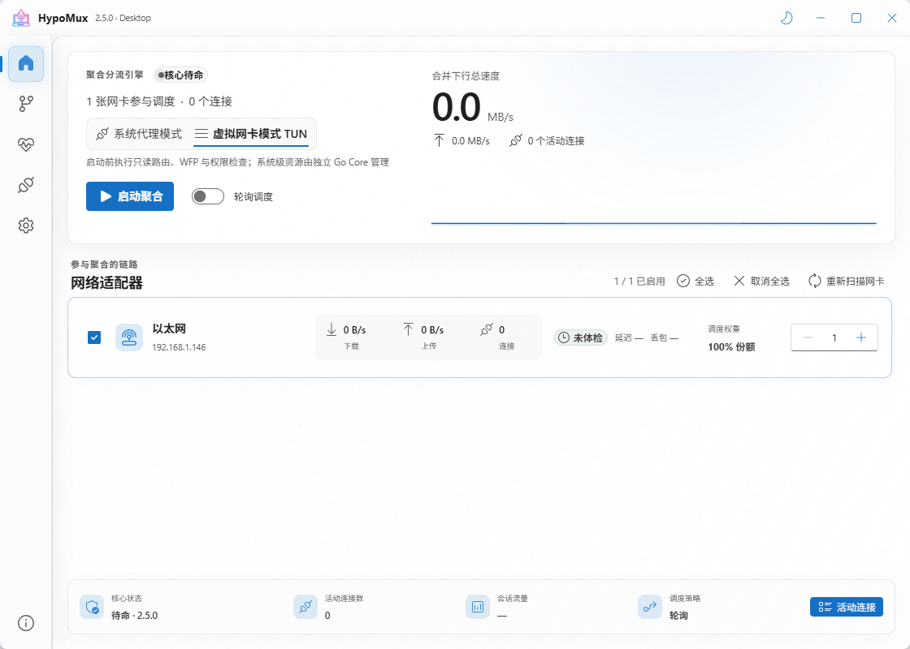
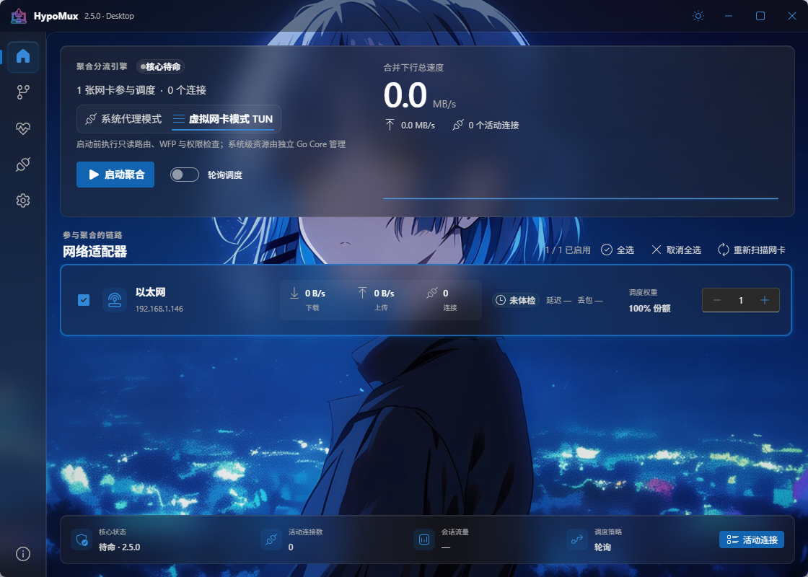

# HypoMux

<p align="center">
  <br><br>
  <a href="README.md">简体中文</a> | <a href="README_EN.md">English</a>
</p>

<p align="center">
  
  
  
  
  
</p>

HypoMux is an open-source multi-adapter aggregation and split-routing utility for Windows. It distributes multi-connection download workloads across active network adapters, allowing Ethernet, Wi-Fi, mobile hotspots, and USB tethering to carry traffic at the same time.

HypoMux balances independent connections; it does not split one TCP connection across multiple paths. It works best with highly concurrent workloads such as Steam updates, IDM downloads, game launchers, and large browser downloads. A single-connection transfer remains limited by that connection.

Website and documentation: [https://hypomux.com](https://hypomux.com)

## Download

> **Windows installer:** [GitHub Releases](https://github.com/Hypostasis-Cat/HypoMux/releases/latest) · [Tencent CNB Release](https://cnb.cool/Hypostasis-Cat/HypoMux/-/releases/latest)
>
> Download the latest `HypoMux_Setup_*.exe`. See the [Code signing policy](#sponsors) for how releases are signed and published.

## UI preview

<p align="center">
  
</p>

<p align="center">
  
</p>

## Core features

- **System Proxy mode**: Starts local HTTP/HTTPS and SOCKS5 services. It manages the Windows system proxy by default, or can leave Windows unchanged and expose only the local ports to manually configured apps.
- **Virtual NIC mode**: Uses Wintun and sing-box to capture a broader range of system traffic, with WFP, DNS, and routing rules for precise split tunneling.
- **Per-connection adapter scheduling**: Selects an outbound adapter for each new connection, combining source-address binding with `IP_UNICAST_IF` to pin sockets to physical links.
- **Advanced routing rules**: Route by process, domain, IP/CIDR, aggregation, direct connection, Ethernet, Wi-Fi, or one specific adapter.
- **Per-adapter blocked-domain handling**: Remembers domains unavailable through a particular link so later connections are not assigned to it again.
- **Encrypted DNS**: Supports DoH and custom DoT (`tls://hostname[:port]`, configured in Settings → Network & DNS). Server certificates are verified; failed DoT queries never downgrade to plaintext DNS.
- **Live telemetry and diagnostics**: Shows adapter throughput, connection counts, and combined speed, with packet-loss, latency, jitter, DNS, gateway, and source-binding checks.
- **Least-privilege architecture**: The UI does not stay elevated. After a normal installation, only the independent Core service has the network-management permissions it needs.

### Choosing a mode

| Mode | Coverage | Privileges and compatibility | Recommended use |
| --- | --- | --- | --- |
| System Proxy | Applications that honor the Windows system proxy or are configured with the local HTTP/SOCKS5 ports | Lightweight; optional system-proxy management; no virtual adapter | IDM, browsers, Steam, and other proxy-aware downloads |
| Virtual NIC | Broader TCP/UDP and non-proxy-aware traffic | Requires the Core service and Wintun/WFP; cannot share the default route with another TUN | Game-launcher downloads, WeGame, advanced split routing, and broader capture |

## Quick start

1. Connect the PC to at least two working networks, such as Ethernet + Wi-Fi or broadband + USB/mobile tethering.
2. Start HypoMux, refresh the Home page, and select the active adapters to include in the pool.
3. Run Network Health first and verify that every link has a valid IPv4 address, gateway, DNS, and working source binding.
4. Choose System Proxy or Virtual NIC mode. Add games, voice chat, and meeting applications to direct rules when latency matters.
5. Enable the aggregation engine, then start the download. If Steam was already running, restart it when prompted so the proxy change takes full effect.
6. Stop aggregation or exit normally when finished. HypoMux restores the system network settings it owned.

## Command line (CLI)

The installer ships an official command-line client, `bin\hypomux-cli.exe`. It uses the same authenticated Core Service pipe as the desktop app (authenticated by install path + SHA-256 fingerprint) and drives the same aggregation engine, which makes unattended scripting and AI Agent workflows straightforward:

```powershell
# List aggregatable adapters, then start system-proxy aggregation
hypomux-cli adapters
hypomux-cli start --adapter Ethernet --adapter "Wi-Fi:3" --socks-port 10800 --http-port 10801

# Status, telemetry, DNS and link diagnostics (--json returns raw protocol v1 results)
hypomux-cli status
hypomux-cli telemetry --connections
hypomux-cli dns resolve example.com
hypomux-cli diagnose --src-ip 192.168.1.10

# Stop aggregation
hypomux-cli stop
```

See the [official CLI architecture note](docs/architecture/official-cli.md) for the command surface, security model, and Agent integration details.

## Using HypoMux with Clash and other proxy clients

To use Clash/Mihomo together with multi-NIC aggregation, use chain mode: Clash keeps the system proxy, its TUN, nodes and rules, and hands every node connection to HypoMux, which spreads them across adapters. The two apps do not compete for the system proxy or the default route, and no loop is formed.

1. Open Settings → Network → Local proxy, choose **Set up** next to the Clash option, turn off Windows system proxy management as prompted, and start aggregation in System Proxy mode.
2. Copy the generated extend script into Clash Verge Rev's Global Extend Script, or create a JavaScript override in Mihomo Party / Clash Nyanpasu. Hand-written configurations can use the generated Mihomo YAML instead.
3. The script adds `dialer-proxy` to every node and provider, pointing at a hidden fallback group. While HypoMux runs, nodes are reached through its SOCKS5 port (TCP and UDP, so Hysteria2 and TUIC nodes work too); when it stops, Clash falls back to connecting nodes directly within about 30 seconds.
4. `DIRECT` rule targets are aggregated too by default; clear the option in the dialog if you do not want this. LAN and private addresses, and direct rules pinned by process, source or inbound, stay truly direct.

Other clients (only node traffic is aggregated; traffic their rules send direct is not):

- **sing-box** (including GUI.for.SingBox): copy the sing-box outbound from the same dialog and set `"detour": "hypomux"` on every node outbound. There is no automatic fallback, so remove the detour while HypoMux is stopped.
- **v2rayN, Hiddify, NekoBox and others**: if the client supports an upstream or chained proxy, set SOCKS5 `127.0.0.1:10800` as the first hop; otherwise use the TUN option below.

**When HypoMux uses TUN mode**: two TUNs cannot both own the default route, so turn off the client's TUN and keep only its system proxy, then choose **Aggregate proxy cores** in the chain dialog. HypoMux adds aggregation process rules for running Mihomo, FlClash, Xray/V2Ray, Hiddify and NekoBox cores; existing rules that point those processes elsewhere are left untouched. sing-box cores share their name with HypoMux's own core and cannot be told apart, so use the detour option for them.

## Compatibility with third-party proxies and game accelerators

HypoMux detects common process families such as UU, Xunyou, Leigod, Qiyou, Clash/Mihomo, v2rayN, Hiddify, Shadowsocks, and Proxifier, and bypasses them to avoid proxy loops. Keep in mind:

- Two applications should not compete for the Windows system-proxy switch. Disable the other application's system-proxy takeover before enabling HypoMux System Proxy mode.
- If another product creates a TUN/VPN adapter and owns the default route, close it before starting HypoMux Virtual NIC mode. HypoMux detects this conflict and blocks startup before changing the system network.

See the [routing documentation](https://hypomux.com/en/docs/routing#third-party-proxies-and-accelerators) for more.

## How it works

```text
Application connections
   │
   ├─ System Proxy: HTTP/HTTPS 10801 · SOCKS5 10800
   └─ Virtual NIC: Wintun + sing-box + WFP/DNS/routing rules
                              │
                       hypomux-engine.exe
                              │
                 Aggregation / direct / adapter route
                    ┌─────────┼─────────┐
                  NIC 1     NIC 2     NIC 3
                    └─────────┴─────────┘
                       Combined throughput
```

## Usage notes

Use HypoMux only on devices and network connections you own or are authorized to manage. It is not intended to bypass unauthorized access controls, security measures, or platform restrictions.

- **System changes**: While active, HypoMux may adjust Windows system proxy and routing-related settings, and accelerated traffic is processed locally by its core. These settings are restored when it is stopped or uninstalled.
- **Scope**: Multi-adapter aggregation is **connection-level load distribution**. It cannot make one TCP connection exceed its original path speed, nor does it turn several providers into one bonded link with a single public IP.
- **Latency**: Aggregation targets throughput, not lower latency. Use direct rules or stop aggregation for competitive games, voice chat, and video meetings.
- **Games and anti-cheat**: HypoMux does not read game memory, inject DLLs, or modify private game-protocol packets. Platform and anti-cheat policies vary, so users must still follow the applicable terms of service.

## Real-world results

These images are real multi-adapter, multi-connection tests captured with earlier builds. Actual results depend on each link, the download source, concurrency, storage, and CPU, and are not a performance guarantee.

| IDM multi-threaded download | Steam game update |
| --- | --- |
|  |  |

| WeGame game download | Task Manager throughput |
| --- | --- |
|  |  |

## Development and building

Recommended environment: Windows 10/11, Go 1.26, Node.js 22, pnpm 10, and Wails v3 CLI `v3.0.0`. NSIS is also required to package the installer. The repository's `bin/` directory must contain the official runtime files `sing-box.exe` and `wintun.dll`.

The bundled sing-box version is **1.14.4**, including gVisor support. See the [runtime notes](bin/README.md) for its source and SHA-256 checksums.

```powershell
go install github.com/wailsapp/wails/v3/cmd/wails3@v3.0.0
pnpm --dir desktop/frontend install --frozen-lockfile
Push-Location desktop
wails3 generate bindings -clean=true -ts -i
Pop-Location

go -C engine test ./...
go -C desktop test ./...
pnpm --dir desktop/frontend build

Set-Location desktop
wails3 dev
# Or build the NSIS installer
wails3 task windows:package
```

See [`.github/workflows/build.yml`](.github/workflows/build.yml) for the complete release pipeline.

## Acknowledgments

HypoMux is built on these excellent open-source projects:

| Project | Role in HypoMux |
| --- | --- |
| [Wails](https://github.com/wailsapp/wails) | Desktop application framework |
| [sing-box](https://github.com/SagerNet/sing-box) | TUN core for Virtual NIC mode |
| [Wintun](https://www.wintun.net/) | Windows virtual adapter driver |
| [gVisor](https://github.com/google/gvisor) | User-space network stack used by sing-box |
| [React](https://github.com/facebook/react) · [Fluent UI](https://github.com/microsoft/fluentui) | Desktop interface |
| [pion/stun](https://github.com/pion/stun) | STUN and NAT detection |
| [go-winio](https://github.com/microsoft/go-winio) | Windows named-pipe communication |
| [NSIS](https://nsis.sourceforge.io/) | Windows installer |

Thanks to everyone who has contributed code to this project. Pull requests are welcome:

<a href="https://github.com/Hypostasis-Cat/HypoMux/graphs/contributors">
  
</a>

## Sponsors

<p>
  <a href="https://signpath.io/"></a>
</p>

Free code signing provided by [SignPath.io](https://signpath.io/), certificate by [SignPath Foundation](https://signpath.org/).

**Code signing policy**

- **Releases**: Official installers are built from this repository by GitHub Actions and signed through SignPath; the publisher should show as **SignPath Foundation**. GitHub Releases is the authoritative release page and Tencent CNB Release is the official mainland China mirror; both distribute the same installer. Automatic updates use a separate signed update channel and verify the Ed25519 manifest, installer size, SHA-256, and Authenticode signature.
- **Committer and reviewer**: [Hypostasis-Cat](https://github.com/Hypostasis-Cat). Pull requests from non-committers must be reviewed by the maintainer before merging.
- **Approver**: [Hypostasis-Cat](https://github.com/Hypostasis-Cat). Each production signing request is manually approved in SignPath.
- **Privacy policy**: HypoMux does not sell personal data or upload telemetry by default. It communicates with other networked systems only when the user or operator requests the relevant feature: forwarding selected traffic, checking for updates, downloading installers, and validating connectivity. The optional built-in AI assistant sends conversations and necessary tool results to the model API configured by the user. Enabling external MCP makes selected data available to the connected AI client. Diagnostics are redacted by default, but application names, adapter identifiers, routing values, and manually entered text can contain personal information. See [AI assistant and external MCP](docs/AI_ASSISTANT.md).

## Support the project

HypoMux is developed and maintained by a student in their spare time, and its core features remain free. If it has helped you, you can support it with a donation by scanning a code below. Thank you to everyone on the [Supporter Wall](https://hypomux.com/en/sponsor/wall/). Donations are voluntary gifts: they are not commercial customization and do not influence the project's direction.

<div align="center">
  <table>
    <tr>
      <td align="center" width="320">
        
        <br />
        <sub>WeChat (leave a nickname; otherwise listed as anonymous)</sub>
      </td>
      <td align="center" width="320">
        
        <br />
        <sub>Alipay (leave a nickname; otherwise listed as anonymous)</sub>
      </td>
    </tr>
  </table>
</div>

## Star History

[](https://star-history.com/#Hypostasis-Cat/HypoMux&Date)

## License

This project is licensed under the **AGPL-3.0** License. The software is provided "as is", and the author assumes no liability for any direct or indirect damages resulting from its use.
